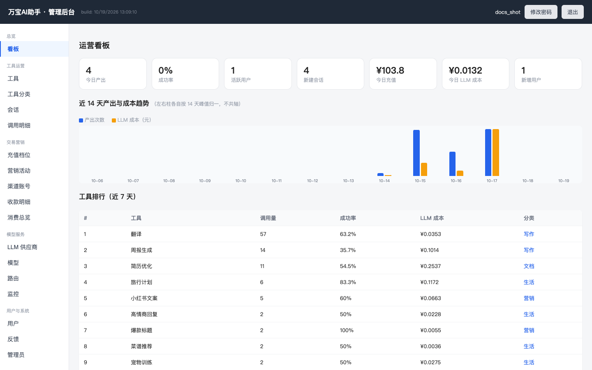
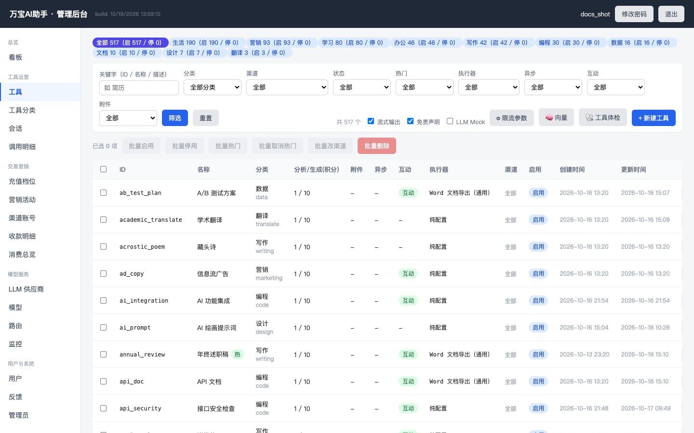
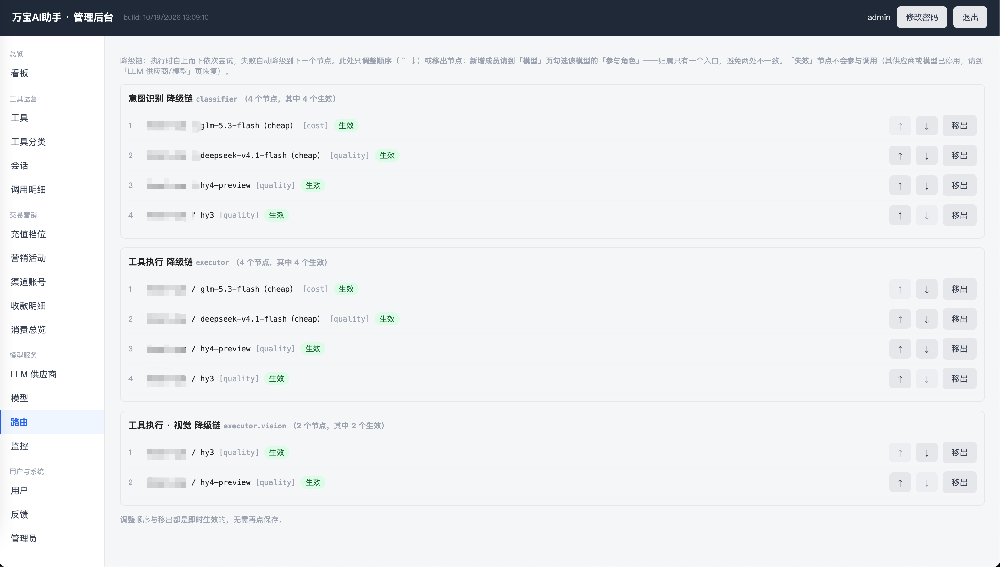

# 万宝AI助手 · 后端

## 目录

- [特性](#特性)
- [截图](#截图)
- [部署指南](#部署指南)
  - [1. 前置准备](#1-前置准备)
  - [2. 配置](#2-配置)
  - [3. 启动](#3-启动)
  - [4. 首次后台配置](#4-首次后台配置)
  - [5. 小程序端接入](#5-小程序端接入)
  - [6. 公网部署要点](#6-公网部署要点)
  - [7. 常见问题](#7-常见问题)
- [自备清单](#自备清单)
- [多渠道与多账户](#多渠道与多账户)
- [文档](#文档)
- [开源范围说明](#开源范围说明)
- [合规提示](#合规提示)
- [联系作者](#联系作者)
- [License](#license)

**一个入口，N 个 AI 工具。** 用户用自然语言描述需求（文本 + 可选附件），Agent 识别意图并调度对应工具，按积分计费。这是「万宝AI助手」微信小程序的服务端——FastAPI + 多供应商 LLM 网关 + 管理后台，前端在 [wanbao-miniprogram](../wanbao-miniprogram) 仓库。

## 特性

- **Agent 意图识别 + 工具调度**：自由输入 → 意图识别 → 候选工具 → 多轮追问补齐信息 → 生成结果，全程单页不跳转
- **多供应商 LLM 网关**：按角色（意图识别/工具执行/向量）维护有序降级链，失败自动降级 + 熔断；成本按 token 估算落库
- **能力标签路由**：模型声明 `vision / function_call / audio_in` 能力，含图请求只路由给支持视觉的模型；支持 `executor.vision` 能力子链表达与主链不同的优先级
- **多模态输入**：图片附件转 base64 data URL 组装 vision 消息（≤6MB/张），文本与图片统一进入模型链路
- **交互式多轮会话**：可配置分析/追问/确认扣费/流式产出，状态落库可恢复
- **计费体系**：积分（次数包）+ 订单 + 渠道账号 + 微信小程序虚拟支付（个人主体可开通）
- **运营看板**：产出/成本趋势、工具排行、零调用筛查、失败红榜、退次榜、系统健康
- **内容安全**：输入/附件/输出三层审查（微信 msgSecCheck 可接入），AI 生成内容显著标识
- **多渠道多账户**：一套后端同时服务 N 个小程序——登录/支付/内容安全/收款限额全渠道独立，工具可按渠道控制可见与定价
- **管理后台**：工具/分类/渠道/供应商/模型/路由/限流/告警全量热配置，无需发版

## 截图

### 运营看板


### 工具管理


### 模型与能力路由


## 部署指南

### 1. 前置准备

| 组件 | 说明 |
|---|---|
| Docker + docker compose | 部署载体（应用单容器，中间件可复用宿主机已有实例）|
| MySQL 5.7+ / 8.0 | 业务库，**启动时自动建库建表**，无需手工跑 SQL |
| Redis | 异步任务队列 + 限流 + 会话检查点 |
| S3 兼容对象存储 | 附件与导出文档（MinIO / rustfs / 阿里 OSS 均可）|
| LLM 供应商 | 至少一家 OpenAI 兼容接口（DeepSeek / 通义 / 智谱 / 混元…）|

### 2. 配置

```bash
git clone https://github.com/hyper-open/wanbao-backend.git
cd wanbao-backend
cp .env.example .env
```

必改项（其余变量均有代码内默认值，可渐进覆盖）：

| 变量 | 说明 |
|---|---|
| `JWT_SECRET` | 登录态签名密钥，**随机长字符串** |
| `DATABASE_URL` | 业务库连接串；docker 部署时主机名用 `host.docker.internal` |
| `MYSQL_ROOT_URL` | root 连接串（自动建库 + 授权用）|
| `REDIS_URL` | Redis 连接串 |
| `S3_ENDPOINT` / `S3_ACCESS_KEY` / `S3_SECRET_KEY` | 对象存储 |
| `ADMIN_PASSWORD` | 后台初始密码，**登录后立即改密** |

### 3. 启动

```bash
docker compose build
docker compose up -d
```

首次启动自动完成：建库 → 建表 → 轻量迁移 → 种子数据（4 家供应商占位、模型与降级链、19 个示例工具、管理员、充值档位）。健康检查：`curl http://localhost:28082/api/tools` 返回 200。

> 不想先配 LLM 也能跑：`.env` 里 `LLM_MOCK=1` 走模拟输出，全流程（含扣费/后台）可通，之后再切真实供应商。

### 4. 首次后台配置

浏览器打开 `http://localhost:28082/admin` 登录：

1. **LLM 供应商**：把占位 API Key 换成真实 Key
2. **模型**：为模型勾选能力（支持视觉 / 支持工具调用），模型加入哪个角色的降级链也在此页勾选
3. **路由**：按需调整各角色链的顺序；如需图片请求走独立优先级，配置 `executor.vision` 子链
4. **渠道账号**：填入你的小程序 appid/secret，选择主体类型（个人/企业）与支付通道
5. **内容安全**：切到 wechat 真实审核（需渠道已配 secret），或先用 mock

### 5. 小程序端接入

见 [wanbao-miniprogram](../wanbao-miniprogram) 仓库 README：换 AppID、`baseUrl` 指向本服务、后台「开发设置 → 服务器域名」加入 request 合法域名（必须 HTTPS）。

### 6. 公网部署要点

- 应用端口 `28082`（可在 compose 改），生产建议前置 Nginx 做 HTTPS 与域名
- 微信小程序要求 **HTTPS 合法域名**，且后端域名需完成 ICP 备案
- `FILE_DELIVERY=proxy` 模式下文档下载经后端代理，无需对象存储公网可达

### 7. 常见问题

| 现象 | 原因与处理 |
|---|---|
| 容器内连不上 MySQL/Redis | docker 部署时主机名必须用 `host.docker.internal`（127.0.0.1 指容器自己）|
| 搜索/看板报 Redis 错误 | `REDIS_URL` 未指向容器可达地址 |
| 含图请求报「未配置视觉模型」 | 「模型」页给支持视觉的模型勾选「支持视觉」，或配 `executor.vision` 子链 |
| 调用一直 pending | reaper 会在超时后自动标失败并退次；检查 worker 日志与 Redis 连通性 |
| 登录密码不对 | 密码只在 seed 建号时写入，改 `.env` 不会更新已有账号——后台「管理员」页改密 |

### 自备清单

| 项 | 用途 |
|---|---|
| 微信小程序 AppID | 前端运行与 wx.login 身份 |
| LLM 供应商 API Key | 意图识别与工具执行（DeepSeek/通义/智谱/混元等 OpenAI 兼容接口均可）|
| S3 兼容对象存储 | 附件与导出文档 |
| 微信虚拟支付（可选）| 个人主体可开通，管理后台「支付与交易」配置 |

## 多渠道与多账户

一套后端可以同时挂 **N 个小程序/应用**（渠道），这是本项目区别于大多数开源工具箱的设计：

- **渠道 = 一个接入实体**：每个渠道（`channel_account`）独立配置微信凭据（appid/secret）、登录 Mock、主体类型（个人/企业）、支付通道、虚拟支付密钥（OfferID/AppKey/推送密钥）与**月收款限额**，互不影响
- **请求识别**：小程序端请求带 `X-App-Id` 头，后端按头定位渠道；渠道停用即整渠道下线
- **工具可见性**：工具可配置可见渠道（空 = 全渠道），类目/列表/搜索/详情/意图识别候选池全部按渠道收缩——矩阵里的每个小程序可以有不同的工具货架
- **渠道定价**：同一工具可按渠道覆盖积分定价（`channel_pricing`）
- **支付隔离**：虚拟支付三级回落（渠道级 OfferID/AppKey → 全局支付配置 → 代码默认），沙箱开关安全侧兜底

配置入口：管理后台「渠道账号」页，字段字典见 [docs/channel-account.md](docs/channel-account.md)。

## 文档

- [系统设计](docs/design.md) —— 架构、数据模型、Agent 调度、LLM 网关与能力路由（§7.3/§7.3.4）、多轮会话
- [计费流程](docs/billing-flow.md)
- [渠道账号](docs/channel-account.md)
- [合规清单](docs/compliance-checklist.md)
- [隐私政策](docs/privacy-policy.md) / [用户协议](docs/user-agreement.md)

## 开源范围说明

- `app/seed_tools.json` 随附 **19 个示例工具**（覆盖全部 10 个分类）；仓库作者的完整工具库（500+）为私有资产，不在开源范围
- 集成测试（`tests/` 目录）需本地服务运行，凭 `ADMIN_PASSWORD` 环境变量登录

## 合规提示

- 小程序内 AI 生成内容已做显著标识（顶部提示条 + 逐条角标）；若你的产品含 AI 问答/生成能力，**上线需申请「深度合成」相关服务类目**，该类目仅向企业/组织主体开放
- 请遵守《生成式人工智能服务管理暂行办法》：如自行面向公众提供生成服务，需完成相应算法备案或与已备案供应商签署合作协议

## 联系作者

- 技术问题 / Bug 反馈：请提 [Issue](../../issues)，方便沉淀给后来人
- 交流 / 合作：扫码添加微信（备注 GitHub）

<p align="center"></p>

## License

[MIT](LICENSE)
