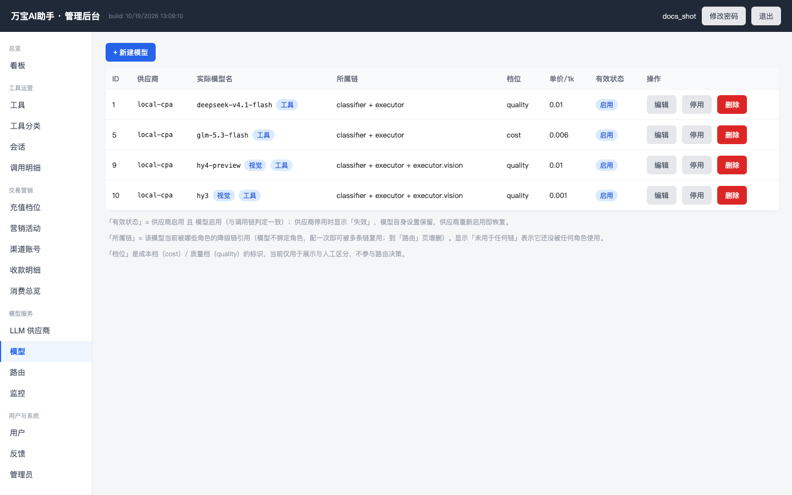

# 万宝AI助手 · 后端

**一个入口，N 个 AI 工具。** 用户用自然语言描述需求（文本 + 可选附件），Agent 识别意图并调度对应工具，按积分计费。这是「万宝AI助手」微信小程序的服务端——FastAPI + 多供应商 LLM 网关 + 管理后台，前端在 [wanbao-miniprogram](../wanbao-miniprogram) 仓库。

## 特性

- **Agent 意图识别 + 工具调度**：自由输入 → 意图识别 → 候选工具 → 多轮追问补齐信息 → 生成结果，全程单页不跳转
- **多供应商 LLM 网关**：按角色（意图识别/工具执行/向量）维护有序降级链，失败自动降级 + 熔断；成本按 token 估算落库
- **能力标签路由**：模型声明 `vision / function_call / audio_in` 能力，含图请求只路由给支持视觉的模型；支持 `executor.vision` 能力子链表达与主链不同的优先级
- **多模态输入**：图片附件转 base64 data URL 组装 vision 消息（≤6MB/张），文本与图片统一进入模型链路
- **交互式多轮会话**：可配置分析/追问/确认扣费/流式产出，状态落库可恢复
- **计费体系**：积分（次数包）+ 订单 + 渠道账号 + 微信小程序虚拟支付（个人主体可开通）
- **运营看板**：产出/成本趋势、工具排行、零调用筛查、失败红榜、退次榜、系统健康
- **内容安全**：输入/附件/输出三层审查（微信 msgSecCheck 可接入），AI 生成内容显著标识
- **管理后台**：工具/分类/渠道/供应商/模型/路由/限流/告警全量热配置，无需发版

## 截图

### 运营看板


### 工具管理


### 模型与能力路由


## 快速开始

### 前置要求

- Docker + docker compose
- MySQL 5.7+/8.0、Redis、任意 S3 兼容对象存储（如 MinIO/rustfs）
- 一个微信小程序（个人主体即可）与至少一家 LLM 供应商的 API Key

### 部署

```bash
cp .env.example .env        # 填入数据库/Redis/S3/管理员密码
docker compose build
docker compose up -d
```

启动时自动建库、建表、种子数据（供应商/模型/路由/19 个示例工具/管理员/充值档位）。

然后：

1. 浏览器打开 `http://localhost:28082/admin`，用 `.env` 里的 `ADMIN_USERNAME/ADMIN_PASSWORD` 登录
2. 「LLM 供应商」页把占位 API Key 换成真实 Key
3. 「模型」页为模型勾选能力（支持视觉/支持工具调用），按需在「路由」页调整降级链
4. 小程序端见 [wanbao-miniprogram](../wanbao-miniprogram) 仓库

### 自备清单

| 项 | 用途 |
|---|---|
| 微信小程序 AppID | 前端运行与 wx.login 身份 |
| LLM 供应商 API Key | 意图识别与工具执行（DeepSeek/通义/智谱/混元等 OpenAI 兼容接口均可）|
| S3 兼容对象存储 | 附件与导出文档 |
| 微信虚拟支付（可选）| 个人主体可开通，管理后台「支付与交易」配置 |

## 文档

- [系统设计](docs/design.md) —— 架构、数据模型、Agent 调度、LLM 网关与能力路由（§7.3/§7.3.4）、多轮会话
- [计费流程](docs/billing-flow.md)
- [渠道账号](docs/channel-account.md)
- [合规清单](docs/compliance-checklist.md)
- [隐私政策](docs/privacy-policy.md) / [用户协议](docs/user-agreement.md)

## 开源范围说明

- `app/seed_tools.json` 随附 **19 个示例工具**（覆盖全部 10 个分类）；仓库作者的完整工具库（500+）为私有资产，不在开源范围
- 集成测试（`test_*.py`）需本地服务运行，凭 `ADMIN_PASSWORD` 环境变量登录

## 合规提示

- 小程序内 AI 生成内容已做显著标识（顶部提示条 + 逐条角标）；若你的产品含 AI 问答/生成能力，**上线需申请「深度合成」相关服务类目**，该类目仅向企业/组织主体开放
- 请遵守《生成式人工智能服务管理暂行办法》：如自行面向公众提供生成服务，需完成相应算法备案或与已备案供应商签署合作协议

## License

[MIT](LICENSE)
